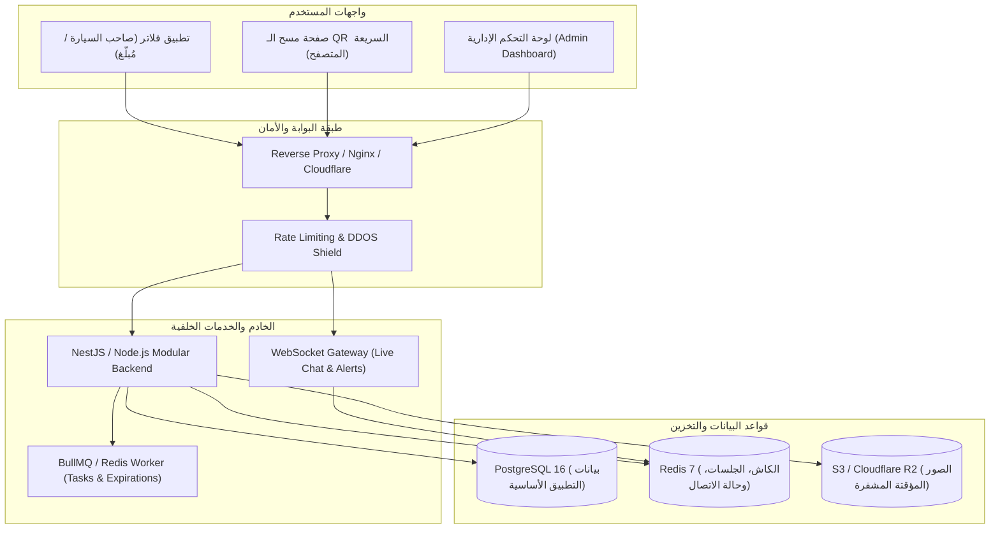
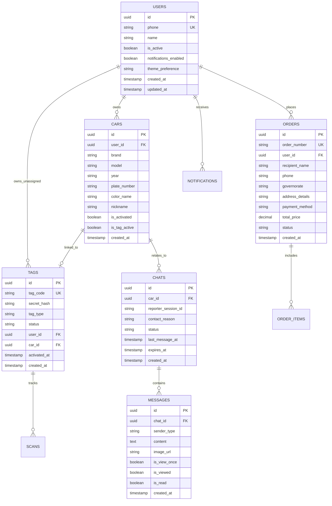
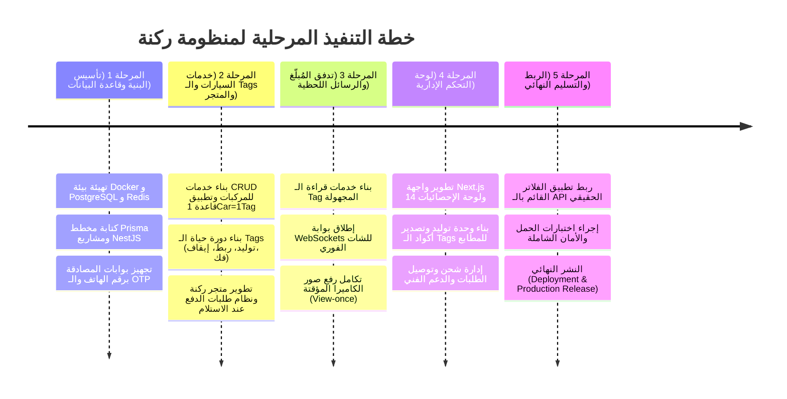

# خطة العمل الشاملة: النظام الخلفي وقاعدة البيانات ولوحة التحكم
# Rakna Backend API, Database & Admin Dashboard Blueprint 🚗⚡

وثيقة التصميم الهندسي والمعماري المتكامل لبناء وتطوير النظام الخلفي (Backend API)، قاعدة البيانات (Database)، ولوحة التحكم الإدارية (Admin Dashboard) لتطبيق **ركنة (Rakna)**، بما يتوافق 100% مع منطق الأعمال وشاشات تطبيق الفلاتر القائم.

---

## 📑 فهرس الخطة (Table of Contents)
1. [نظرة عامة والمعمارية العامة (Architecture Overview)](#1-نظرة-عامة-والمعمارية-العامة)
2. [حزمة التقنيات المقترحة (Tech Stack Selection)](#2-حزمة-التقنيات-المقترحة)
3. [تصميم ومخطط قاعدة البيانات (Database Schema & ERD)](#3-تصميم-ومخطط-قاعدة-البيانات)
4. [مواصفات واجهات البرمجة (RESTful API & WebSockets Specs)](#4-مواصفات-واجهات-البرمجة)
5. [منطق الأعمال وقواعد النظام الحصرية (Business Logic & Rules)](#5-منطق-الأعمال-وقواعد-النظام)
6. [لوحة التحكم الإدارية (Admin Dashboard Architecture)](#6-لوحة-التحكم-الإدارية)
7. [الأمان، الخصوصية، والتعامل مع الوسائط (Security & Media Management)](#7-الأمان-والخصوصية)
8. [خريطة الطريق ومراحل التنفيذ (Implementation Roadmap)](#8-خريطة-الطريق-ومراحل-التنفيذ)

---

## 1. نظرة عامة والمعمارية العامة

يقوم نظام **ركنة** على مبدأ **الوساطة المجهولة (Zero-Knowledge Broker)**؛ حيث يربط بين المُبلّغ (Reporter) وصاحب السيارة (Car Owner) عبر ملصق ذكي (`Rakna Tag`) يعمل بتقنيتي NFC و QR دون كشف هوية أي طرف للآخر، ودون تخزين أي بيانات شخصية يمكن للمُبلّغ الاطلاع عليها.



---

## 2. حزمة التقنيات المقترحة (Tech Stack Selection)

تم اختيار التقنيات بعناية لضمان الأداء الفائق، التزامن اللحظي، والتوافق مع نظام كود TypeScript الحديث:

| الطبقة | التقنية المعتمدة | سبب الاختيار |
| :--- | :--- | :--- |
| **Backend Framework** | **NestJS (Node.js + TypeScript)** | هيكلية معيارية تشبه Clean Architecture، دعم تلقائي للـ DTOs، Swagger، و WebSockets. |
| **Primary Database** | **PostgreSQL 16+** | أقوى محرك قواعد بيانات علائقية مع دعم لبيانات JSONB، والـ UUIDs، والنزاهة العالية. |
| **ORM / Query Builder** | **Prisma ORM** | كتابة آمنة (Type-Safe)، توليد تلقائي للمخططات والـ Migrations، وسرعة وسهولة التعديل. |
| **In-Memory Cache & Pub/Sub** | **Redis 7** | إدارة رموز الـ OTP، الـ Rate Limiting، الكاش، وبث رسائل الشات اللحظية عبر الـ WebSockets. |
| **Real-time Messaging** | **Socket.io / WebSockets** | تحديث المحادثات والتنبيهات وحالة الـ Tag فورياً دون الحاجة لإعادة تحميل الصفحة. |
| **Object Storage** | **S3 / Cloudflare R2** | تخزين صور بلاغات السيارات الملتقطة بالكاميرا مع ميزة الروابط الموقوتة وحذفها تلقائياً. |
| **Admin Dashboard UI** | **Next.js 14+ (App Router) + Tailwind CSS** | أداء عالي وسرعة في عرض الجداول والرسوم البيانية، مع تصميم متوافق مع هوية ركنة الذهبية والداكنة. |
| **Deployment & Containers** | **Docker & Docker Compose** | بيئة تشغيل موحدة للتطوير والإنتاج تتيح تشغيل كامل المنظومة بضغطة زر. |

---

## 3. تصميم ومخطط قاعدة البيانات (Database Schema & ERD)

### مخطط الجداول والعلاقات الأساسية:



### تفاصيل الجداول والحقول (Table Definitions):

#### 1. جدول المستخدمين (`users`)
- `id` (UUID, Primary Key): المعرّف الفريد.
- `phone` (VARCHAR(15), Unique, Indexed): رقم الهاتف بصيغة الدولة المصرية (`+201XXXXXXXXX`).
- `name` (VARCHAR(100)): اسم المالك (افتراضياً: مشتق أو مدخل من المستخدم).
- `is_verified` (BOOLEAN): حالة التحقق من رقم الهاتف عبر OTP.
- `role` (ENUM: `OWNER`, `SUPPORT`, `ADMIN`, `SUPER_ADMIN`): الصلاحية في النظام.
- `is_blocked` (BOOLEAN): حظر الحساب في حال مخالفة المعايير.
- `notifications_enabled` (BOOLEAN): حالة تفعيل الإشعارات الفورية.
- `created_at`, `updated_at` (TIMESTAMP WITH TIME ZONE).

#### 2. جدول المركبات (`cars`)
- `id` (UUID, Primary Key).
- `user_id` (UUID, Foreign Key -> `users.id` ON DELETE CASCADE).
- `brand` (VARCHAR(50)): ماركة السيارة (مثل: Toyota, Hyundai).
- `model` (VARCHAR(50)): موديل السيارة (مثل: Corolla, Elantra).
- `year` (VARCHAR(4)): سنة الصنع.
- `plate_number` (VARCHAR(20)): رقم اللوحة (مرئي للمالك فقط كمعرف).
- `color_name` (VARCHAR(30)): اسم اللون المختار ديناميكياً (`أبيض لؤلؤي`, `أسود داكن`, `الجرافيت`, `فضي`, `أزرق`, `أحمر`).
- `nickname` (VARCHAR(50)): الاسم المستعار الاختياري (مثل: *سيارة العمل*).
- `is_activated` (BOOLEAN): هل تم ربطها بـ Tag نشط (افتراضياً `false`).
- `is_tag_active` (BOOLEAN): هل استقبال التنبيهات يعمل أم متوقف مؤقتاً (`pause`).

#### 3. جدول الـ Tags الذكية (`tags`)
- `id` (UUID, Primary Key).
- `tag_code` (VARCHAR(20), Unique, Indexed): كود الـ Tag العام والمطبوع (مثل: `#A247` أو `TAG-8821`).
- `secret_token` (VARCHAR(64), Unique): رمز سري مشفر لشريحة NFC لمنع التزييف.
- `tag_type` (ENUM: `TRUNK_BADGE`, `NANO_GLASS`): نوع وخامة الملصق.
- `status` (ENUM: `IN_STOCK`, `UNASSIGNED`, `ACTIVE`, `PAUSED`, `REVOKED`): حالة الملصق.
- `user_id` (UUID, Nullable, Foreign Key -> `users.id`): المالك الحالي للملصق.
- `car_id` (UUID, Nullable, Unique, Foreign Key -> `cars.id`): السيارة المربوط بها (تطبيق قاعدة **1 Car = 1 Tag** عبر قيد Unique).
- `batch_number` (VARCHAR(50)): رقم دفعة الإنتاج لتتبع الجودة في لوحة التحكم.

#### 4. جدول المحادثات المجهولة (`chats`)
- `id` (UUID, Primary Key).
- `car_id` (UUID, Foreign Key -> `cars.id`).
- `reporter_session_token` (VARCHAR(128), Indexed): توكن مجهول خاص بجلسة المُبلّغ (لا يحتاج لحساب).
- `contact_reason` (ENUM: `CAR_BLOCKING`, `LIGHTS_ON`, `CAR_INCIDENT`, `CONSTRUCTION`, `OTHER`).
- `status` (ENUM: `ACTIVE`, `RESOLVED`, `BLOCKED`, `EXPIRED`).
- `expires_at` (TIMESTAMP): تاريخ الحذف التلقائي للمحادثة (30 يوماً افتراضياً).

#### 5. جدول الرسائل (`messages`)
- `id` (UUID, Primary Key).
- `chat_id` (UUID, Foreign Key -> `chats.id` ON DELETE CASCADE).
- `sender_type` (ENUM: `REPORTER`, `OWNER`, `SYSTEM`).
- `content` (TEXT): نص الرسالة (بحد أقصى 500 حرف).
- `image_url` (TEXT, Nullable): مسار الصورة الملتقطة عبر الكاميرا فقط.
- `is_view_once` (BOOLEAN): ميزة العرض لمرة واحدة.
- `is_viewed` (BOOLEAN): هل تم فتح الصورة ومشاهدتها.
- `is_read` (BOOLEAN): حالة قراءة الرسالة من الطرف الآخر (Double Checkmark).

#### 6. جدول الطلبات والمتجر (`orders` & `order_items`)
- `id` (UUID, Primary Key).
- `order_number` (VARCHAR(20), Unique): رقم الطلب للعميل (مثل `#RK-48921`).
- `user_id` (UUID, Foreign Key -> `users.id`).
- `recipient_name` (VARCHAR(100)): اسم المستلم للشحن.
- `phone` (VARCHAR(15)): رقم هاتف التواصل مع مندوب الشحن.
- `governorate` (VARCHAR(50)): المحافظة المصرية المختارة.
- `address_details` (TEXT): العنوان التفصيلي.
- `total_price` (DECIMAL(10, 2)): إجمالي المبلغ بالجنيه المصري.
- `payment_method` (ENUM: `COD`): الدفع عند الاستلام.
- `status` (ENUM: `PENDING`, `PROCESSING`, `SHIPPED`, `DELIVERED`, `CANCELLED`).

#### 7. جدول الإشعارات (`notifications`)
- `id` (UUID, Primary Key).
- `user_id` (UUID, Foreign Key -> `users.id`).
- `car_id` (UUID, Nullable, Foreign Key -> `cars.id`).
- `tag_code` (VARCHAR(20), Nullable).
- `type` (ENUM: `CAR_ALERT`, `TAG_SCAN`, `SECURITY`, `CHAT`, `SYSTEM`).
- `title` (VARCHAR(150)): عنوان التنبيه.
- `message` (TEXT): تفاصيل التنبيه.
- `action_label` (VARCHAR(50)): نص الزر التفاعلي (مثل: *"تواصل مع صاحب البلاغ"*).
- `is_read` (BOOLEAN): حالة القراءة.

---

## 4. مواصفات واجهات البرمجة (RESTful API & WebSockets Specs)

### أ. واجهات المصادقة والحساب (`/api/v1/auth`)
- `POST /auth/phone/send-otp`: إرسال كود التحقق لرقم الهاتف المصري (Rate-limit: 3 طلبات كل 10 دقائق).
- `POST /auth/phone/verify-otp`: التحقق من كود الـ 6 أرقام وتوليد الـ JWT Access Token والـ Refresh Token.
- `GET /auth/me`: جلب بيانات الحساب الشخصي الحالية.
- `PATCH /auth/me`: تحديث الاسم ورقم الهاتف وتفضيلات الثيم والإشعارات.

### ب. واجهات إدارة المركبات (`/api/v1/cars`)
- `GET /cars`: جلب كافة مركبات المالك مع حالة الـ Tag المرتبط ومواصفات كل سيارة.
- `POST /cars`: إضافة سيارة جديدة (تكون افتراضياً غير مفعلة وبدون Tag).
- `GET /cars/:id`: جلب تفاصيل سيارة محددة.
- `PATCH /cars/:id`: تعديل بيانات السيارة (الموديل، الاسم المستعار، رقم اللوحة، اللون).
- `DELETE /cars/:id`: حذف السيارة مع فك ارتباط الـ Tag تلقائياً وإعادته متاحاً للمالك.

### ج. واجهات إدارة ملصقات الـ Tags (`/api/v1/tags`)
- `GET /tags/my-tags`: جلب ملصقات المستخدم مقسمة إلى: **مرتبطة بنشاط** و **متاحة غير مربوطة**.
- `POST /tags/activate`: ربط ملصق متاح بسيارة غير مفعلة (تنفيذ قاعدة `1 Car = 1 Tag`).
- `POST /tags/:tagCode/toggle-pause`: إيقاف أو استئناف إشارة الـ Tag مؤقتاً.
- `POST /tags/:tagCode/unlink`: فك ارتباط الـ Tag عن السيارة وإعادته للمحفظة.
- `POST /tags/claim`: تفعيل كود Tag جديد اشتراه المستخدم أو استلمه.
- `GET /tags/:tagCode/test-signal`: فحص جاهزية شريحة NFC، كود QR، واستقبال التنبيهات.

### د. واجهات تدفق المُبلّغ والمسح (`/api/v1/reporter`)
- `GET /reporter/resolve-tag/:tagCode`: قراءة الـ Tag وإرجاع بيانات السيارة المجهولة (اللون، الموديل، كود الـ Tag، حالة التشغيل) دون أي بيانات للمالك.
- `POST /reporter/session/init`: بدء جلسة مجهولة للمُبلّغ وتوليد توكن مؤقت.
- `POST /reporter/chats`: إنشاء محادثة جديدة وتحديد سبب التواصل.
- `POST /reporter/chats/:chatId/messages`: إرسال رسالة (نص + صورة بالكاميرا اختيارياً).
- `POST /reporter/chats/:chatId/upload-camera-photo`: رفع صورة الكاميرا وتشفيرها بنظام العرض لمرة واحدة (`view-once`).

### هـ. واجهات المحادثات وصندوق الرسائل (`/api/v1/chats`)
- `GET /chats`: جلب محادثات المالك مع دعم الفلترة (`all` / `unread`).
- `GET /chats/:id/messages`: استعراض رسائل محادثة معينة.
- `POST /chats/:id/messages`: رد مالك السيارة على المُبلّغ.
- `PATCH /chats/:id/mark-read`: تحديد الرسائل كمقروءة.
- `POST /chats/:id/block`: حظر المحادثة ومنع المُبلّغ من إرسال رسائل جديدة.
- `DELETE /chats/:id`: حذف المحادثة من طرف المالك.

### و. واجهات المتجر والطلبات (`/api/v1/store`)
- `GET /store/products`: جلب ملصقات ركنة المتاحة للبيع (ملصق الشنطة 149 ج.م، ملصق الزجاج 129 ج.م، باقة التوفير).
- `POST /store/orders`: إنشاء طلب شراء جديد، تسجيل العنوان والمحافظة المصرية، واختيار الدفع عند الاستلام.
- `GET /store/orders/my-orders`: جلب طلبات المستخدم السابقة ومتابعة الشحن.

### ز. واجهات الإشعارات (`/api/v1/notifications`)
- `GET /notifications`: جلب قائمة الإشعارات مع الفلاتر (`all`, `unread`, `cars`, `tags`).
- `PATCH /notifications/mark-all-read`: تحديد كافة الإشعارات كمقروءة ومسح شارة العداد.
- `DELETE /notifications/:id`: حذف إشعار محدد.
- `DELETE /notifications/clear-all`: تفريغ كافة الإشعارات.

### ح. قنوات البث اللحظي (WebSockets Events)
```text
Gateway Namespace: /ws

Events (Client -> Server):
- join_chat { chatId, token }
- send_message { chatId, content, imageKey }
- typing { chatId, isTyping }
- mark_viewed { messageId }

Events (Server -> Client):
- new_message { message }
- chat_status_changed { status }
- car_tag_scanned { carId, tagCode, timestamp }
- new_notification { notification }
```

---

## 5. منطق الأعمال وقواعد النظام (Business Logic & Rules)

1. **قاعدة 1 Car = 1 Tag الصارمة:**
   - لا يمكن لنفس ملصق الـ Tag أن يرتبط بأكثر من سيارة واحدة في نفس الوقت على مستوى قاعدة البيانات (`UNIQUE constraint on car_id`).
   - عند حذف سيارة، يتحرر الـ Tag تلقائياً ليصبح في حالة `UNASSIGNED` ويبقى في محفظة المستخدم.

2. **الخصوصية الصفرية (Zero-Knowledge Privacy):**
   - لا يتم إرجاع رقم هاتف المالك، اسمه الحقيقي، أو بريده الإلكتروني في أي استجابة API موجهة للمُبلّغ أو قارئ الـ QR.
   - المُبلّغ لا يحتاج لتسجيل حساب؛ يتم إنشاء جلسة عشوائية مشفرة (`Anonymous Session UUID`) تحفظ محلياً في جهازه.

3. **حماية الوسائط والصور (View-Once Camera Protection):**
   - رفع الصور يتم مباشرة عبر الكاميرا فقط مع وضع علامة مائية رقمية وتاريخ ووقت البلاغ.
   - عند فتح المالك للصورة ومشاهدتها، يرسل التطبيق إشارة للباك إند لتحويل `is_viewed = true` ويتم إتلاف رابط التحميل الفوري (`Signed URL revocation`).
   - الحذف التلقائي الدوري لكافة الصور والمحادثات المنتهية بعد 30 يوماً عبر وظيفة مجدولة (`Cron Job / BullMQ Worker`).

4. **معدلات الاستخدام ومكافحة الإزعاج (Rate Limiting & Anti-Spam):**
   - حد أقصى 3 عمليات مسح لكل Tag خلال 5 دقائق من نفس العنوان/الجلسة لمنع الإزعاج.
   - إمكانية تجميد إشارة الـ Tag بضغطة زر (`Pause Tag`) لتعطيل استقبال البلاغات في حال كانت السيارة في جراج آمن.

---

## 6. لوحة التحكم الإدارية (Admin Dashboard Architecture)

لوحة تحكم حديثة قائمة على **Next.js 14+** بنظام الـ App Router وثيم عصري يدعم الوضع الداكن وتدرجات ركنة الذهبية:

```text
dashboard/
├── app/
│   ├── (auth)/login/               # تسجيل دخول المشرفين بنظام 2FA
│   ├── (dashboard)/
│   │   ├── page.tsx                # لوحة المؤشرات والإحصائيات الرئيسية (Dashboard Home)
│   │   ├── tags/                   # إدارة وتوليد ملصقات الـ Tags وطباعة الـ QR
│   │   │   ├── generate/           # توليد دفعات Tags جديدة مع تصدير PDF/SVG
│   │   │   └── [id]/               # فحص سجل وتاريخ أي Tag
│   │   ├── orders/                 # إدارة طلبات المتجر وتحديث حالات الشحن والمحافظات
│   │   ├── cars/                   # سجل المركبات وحالات الربط
│   │   ├── users/                  # إدارة المستخدمين والتحقق والحظر
│   │   ├── incidents/              # سجل البلاغات والتصنيفات (بدون انتهاك خصوصية المحادثات)
│   │   ├── support/                # مركز تذاكر ودعم العملاء
│   │   └── settings/               # إعدادات النظام والبوابات
```

### الميزات الرئيسية للوحة التحكم:
1. **مؤشرات الأداء اللحظية (Live KPIs):**
   - عداد السيارات النشطة، إجمالي ملصقات الـ Tags المفعلة، الطلبات الجديدة قيد الشحن، ومعدل البلاغات اليومية.
2. **وحدة توليد دفعات الـ Tags (Batch Tag Generator):**
   - توليد آلاف الأكواد المشفرة مسبقاً بدقة متناهية، مع إمكانية تصدير رموز QR بدقة متجهة (SVG/PDF) موجهة مباشرة للمطبعة لإنتاج ملصقات الـ Trunk Badges والـ Nano Glass Tags.
3. **إدارة الطلبات والشحن المصري (Orders & Logistics Hub):**
   - فرز الطلبات بحسب المحافظة، تغيير حالة التوصيل، وتأكيد تحصيل مبالغ الدفع عند الاستلام (COD).
4. **نظام الصلاحيات متعدد المستويات (RBAC):**
   - **Super Admin:** صلاحيات كاملة والوصول للإعدادات والتقارير المالية.
   - **Logistics Manager:** إدارة الطلبات والشحن والمخزون فقط.
   - **Support Agent:** الرد على شات واستفسارات الدعم الفني دون الوصول لبيانات المستخدمين الحساسة.

---

## 7. الأمان، الخصوصية، والتعامل مع الوسائط

- **حماية الاتصالات:** تشفير كامل لجميع الاتصالات عبر بروتوكول TLS 1.3 / HTTPS و WSS.
- **تشفير البيانات الحساسة:** تشفير أرقام الهواتف في قاعدة البيانات باستخدام خوارزمية `AES-256-GCM`.
- **التخزين الآمن للصور:** رفع الصور على كتل تخزين خاصة (Private Buckets) وتوليد روابط مؤقتة مشفرة (`Presigned URLs`) بصلاحية 60 ثانية فقط للمالك.
- **مكافحة الهجمات:** حماية شاملة من هجمات DDoS و Brute Force عبر Cloudflare و Redis Rate Limiter.

---

## 8. خريطة الطريق ومراحل التنفيذ (Implementation Roadmap)



---

## 🚀 خطوة البدء الفورية

المجلد الحالي `rakna dashboard&database&API` جاهز لبدء بناء المشروع وفق الهيكل الموصى به:
```text
rakna dashboard&database&API/
├── PLAN.md                 # وثيقة الخطة المعمارية الشاملة (هذا الملف)
├── backend/                # مشروع NestJS API
├── dashboard/              # مشروع Next.js الإداري
└── docker-compose.yml      # بيئة تشغيل PostgreSQL و Redis والخدمات المشتركة
```
